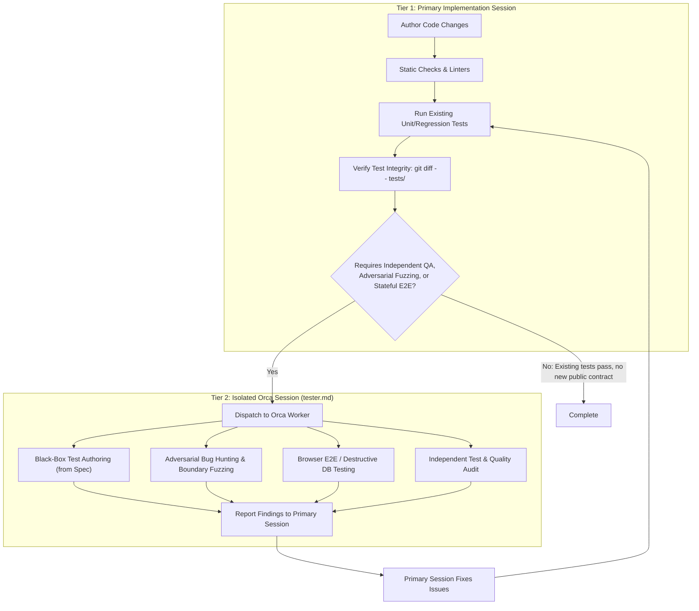

# Orca Isolated Testing & Quality Architecture

Orca orchestration is strictly and exclusively reserved for **testing, adversarial verification, and quality assurance**. Primary implementation sessions focus on planning, design, and code authoring; Orca worker sessions provide independent cognitive distance and environment isolation where they deliver genuine verification value.

## Principles

1. **Testing-Only Scope**
   - Use Orca multi-session orchestration solely for testing and quality verification (black-box test authoring, adversarial edge-case verification, stateful/destructive E2E suites, and independent diff audits).
   - Do not use Orca orchestration for parallel feature authoring, splitting code writes across multiple implementation agents, or multi-branch code generation.

2. **Value-Driven Isolation vs. Fast Feedback**
   - **Do not dispatch trivially**: Spawning an Orca worker merely to run a single, fast, pre-existing test command (e.g., `npm test`, `vendor/bin/pest`) adds latency and token overhead without cognitive benefit.
   - Run pre-existing deterministic unit tests and static checks directly in the primary session for fast feedback loops.
   - Dispatch to an isolated Orca worker session when true cognitive separation (independent tester perspective) or physical isolation (database state, browser processes, destructive filesystem ops) is required.

3. **Strict Test Integrity Invariant (Anti-Tampering)**
   - The primary implementation session must **never modify, weaken, or delete existing test assertions** to make failing code pass.
   - If existing tests fail during development, the agent must fix the production code, never the test.
   - Always verify via `git diff --stat -- tests/` (or matching test directory) before completing an implementation. Modifying existing tests requires explicit user authorization.

4. **Tester Role Specialization**
   - The isolated Orca testing session applies the `.agent-knowledge/static/agents/tester.md` profile.
   - The tester session operates independently and adversarially: it formulates test cases from specifications and requirements rather than rationalizing the developer's implementation choices.

---

## Two-Tier Testing Architecture

### Tier 1: In-Session Regression & Fast Feedback
- **What runs here:** Existing unit tests, integration test suites, linters, type checks, and build scripts that execute deterministically without dirtying the environment.
- **Rules:**
  - Execute directly in the primary session using standard project scripts (`npm test`, `pytest`, `cargo test`, `composer test`).
  - Keep test files untouched unless the user explicitly requested test updates.

### Tier 2: Isolated Orca Sessions (`tester.md`)
Dispatch to an isolated Orca worker session under the following conditions:
1. **Black-Box Spec-Driven Testing**: A dedicated tester agent writes test cases based on the requirement specification or `DESIGN.md` before or independently of the implementation, ensuring zero confirmation bias.
2. **Adversarial & Boundary Bug Hunting**: Testing for insidious edge cases: null/empty inputs, off-by-one, race conditions, concurrency/deadlocks, permission bypasses, and injection payloads.
3. **Heavy / Stateful / Destructive E2E Testing**: Running browser automation suites (Playwright, Cypress, Laravel Dusk) or tests that mutate persistent databases, spawn background daemons, or create volatile filesystem caches (`workspace: "share"` or `"branch"`).
4. **Independent Quality & Diff Audit**: Reviewing the primary agent's changes and test coverage to confirm invariants and ensure no regressions or weakened assertions exist.

---

## Workflow

1. **Primary Session: Implement and Run Fast Checks**
   - The primary session completes an atomic code change.
   - Runs existing unit tests and linters directly for immediate feedback.
   - Checks `git diff --stat -- tests/` to verify test integrity.

2. **Dispatch to Isolated Orca Testing Session (When Applicable)**
   - When new features, critical APIs, security paths, or browser E2E flows are involved, dispatch to Orca.
   - Run Orca commands with host permissions (unsandboxed / `BypassSandbox: true`) because Orca Desktop's runtime socket and state reside in `~/.config/orca`.
   - Prompt the testing session with the target specification and instruct it to apply `.agent-knowledge/static/agents/tester.md`.
   - If tests mutate databases or launch browser processes, run in a dedicated worktree (`workspace: "share"` or `"branch"`).

3. **Isolated Test Execution**
   - The Orca testing session:
     - Formulates boundary tests, fuzzing, or E2E journeys.
     - Executes test suites in its isolated environment.
     - Verifies determinism (no arbitrary sleep timeouts, independent state).

4. **Report Back to Primary Session**
   - The testing session delivers a structured report:
     - Pass / Fail status and exact counts.
     - Failure traces, assertion errors, and observed edge-case bugs.
     - Identified coverage gaps or unverified areas.
   - If defects are found, the primary session fixes the code in the primary workspace and re-verifies.

---

## Request Patterns

Use these patterns to dispatch high-value testing to an isolated Orca session:

### 1. Black-Box Test Authoring from Specification
> Use /orchestration to dispatch a separate testing session applying `.agent-knowledge/static/agents/tester.md`. Read `<spec-or-design-doc>` without inspecting the developer's implementation files. Author comprehensive test cases covering happy path, validation rejections, and unauthorized states for `<feature>`.

### 2. Adversarial Edge-Case and Boundary Fuzzing
> Use /orchestration to have a separate Orca testing session apply `tester.md` on `<changed-components>`. Formulate boundary tests (null bytes, off-by-one, timezone boundaries, large payloads, concurrency race conditions) and report any defect findings back to this session.

### 3. End-to-End (E2E) Browser or Stateful Testing
> Use /orchestration to launch an isolated Orca session for E2E tests (`workspace: "share"`). Run `<e2e-spec-file>` against the local build. Ensure browser artifacts and test database mutations remain isolated in the test workspace, and report failing journeys with trace logs and screenshots.

### 4. Independent Test Integrity and Quality Audit
> Use /orchestration to have a separate testing session audit the git diff of `<branch-or-commit>`. Verify that existing test baselines were not modified or bypassed, and confirm that test coverage adequately exercises all newly added branches and error handlers.
